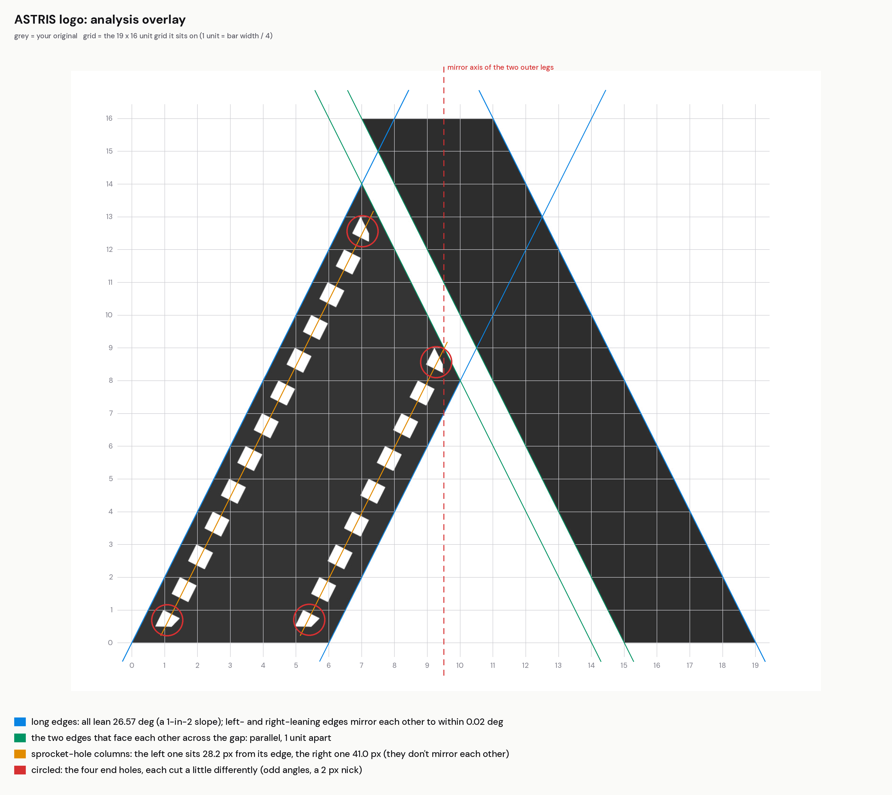
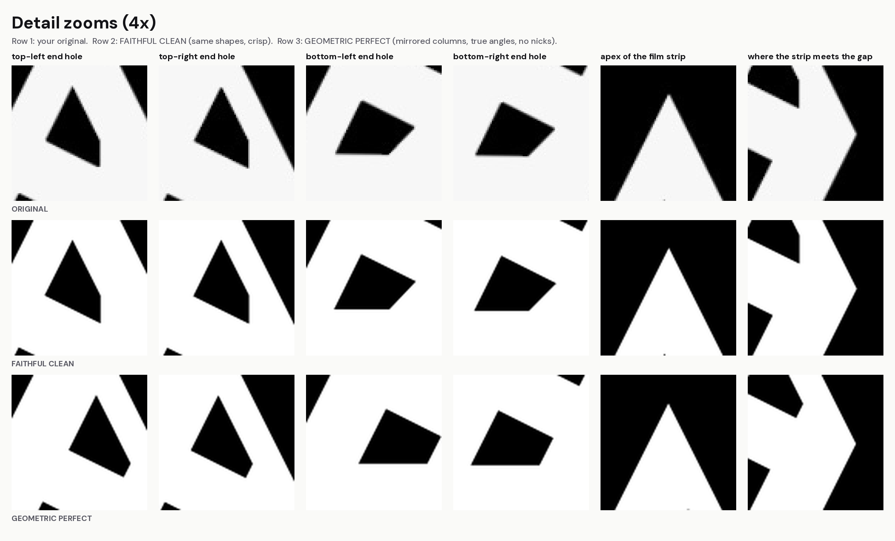
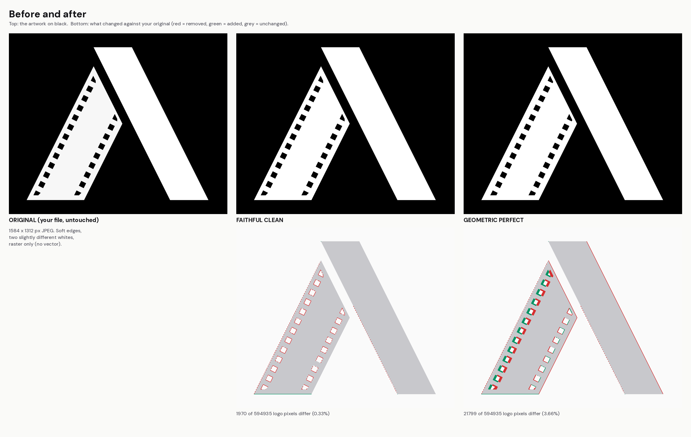

# ASTRIS logo report

I measured your original logo file to a fraction of a pixel before touching anything. The original is untouched in
`00_Originals/astris-logo-original.jpg`. Everything below was measured by `code/logo_pack/analyse_logo.py`,
and every number is saved in `code/logo_pack/logo-measurements.json`.

## The short version

**Your logo's main shape is not off. It is built very precisely.** The legs lean at exactly the same angle, the base
is level, and everything sits on a simple grid. The things that *are* slightly off are small and all inside the film strip:

1. **The film strip is a different white from the bar.** The bar is pure white (255 of 255); the strip is 247, about 3% darker.
2. **The two columns of sprocket holes don't mirror each other.** The left column sits 28.2 px from its edge and the right one 41.0 px, a difference of 12.8 px.
3. **The four part-holes at the ends of the strip are each cut differently**: short vertical cuts at the top, sides at about 44 degrees instead of 26.6 at the bottom, and a 2 px nick on one. The top-right one also sits much closer to the strip's end (18 px) than the top-left one (33 px).
4. **The file is a small JPEG with soft edges**: corners are rounded by up to 1.0 px and there is faint JPEG ringing along the edges. There is no vector version.

There are **no stray pixels**, no gaps and no wobbly lines.

## Symmetry

| Test | Result |
|---|---|
| Mirror left-to-right (whole mark) | best overlap 81% (axis at x = 787 px). The mark is not a mirror image, by design: the bar runs 2 units taller than the strip. |
| Mirror top-to-bottom | best overlap 50%: none, as expected for an A shape |
| Rotation (180 degrees, radial) | overlap 35%: none |
| **The two outer legs** | mirror images about x = 787.1 px. Their angles differ by only 0.001 degrees. |
| Base line | strip and bar both end at y = 1209.88 px (difference 0.00 px) |
| Strip's point vs the bar's top-left corner | vertically in line to 0.06 px |

So the symmetry that the design intends (two legs at the same lean, sharing one base line) is accurate to a few
hundredths of a degree. I would not change it.

## Lines, angles and widths

Every straight edge leans 26.565 degrees from vertical, which is a slope of exactly 1 across for every 2 down.

| Edge | Angle from vertical | Off the ideal by |
|---|---|---|
| strip left (outer) | -26.570 | 0.005 |
| strip right | -26.570 | 0.005 |
| strip cut (faces the bar) | +26.569 | 0.004 |
| bar left (faces the strip) | +26.555 | 0.010 |
| bar right (outer) | +26.569 | 0.004 |

The whole logo fits a **19 x 16 unit grid**, where 1 unit = 69.33 px in your file (a quarter of the bar's width):

| Part | Measured (units) | On the grid |
|---|---|---|
| Bar width | 4.005 | 4 |
| Film strip width | 6.006 | 6 |
| Gap between them | 0.995 | 1 |
| Overall width | 19.008 | 19 |
| Overall height | 16.000 | 16 |
| Height of the strip's point | 14.006 | 14 |

- Bar width: 277.48 px at the top, 277.83 px at the bottom (a 0.35 px taper: invisible).
- Gap: 69.04 px at the strip's point, 68.91 px at its corner. It is 0.35 px narrower than one unit: invisible, but real.
- Edge straightness: on average 0.09 px of ripple (worst single point 0.28 px). That is JPEG noise, not a drawing error.
- Corners: sharp in the design, softened by 0.2 to 1.0 px in the file.

## Sprocket holes

- 22 holes: 13 in the left column, 9 in the right. 18 are whole squares; 4 are part-holes at the ends.
- The whole squares are very consistent: side 39.62 px (varies by only 0.05 px), turned to line up with the strip (worst angle error 0.11 degrees).
- Spacing is even: 77.50 px apart along the strip (varies by 0.01 px), which is exactly one unit measured straight down.
- Left and right holes sit level with each other (offset 294.6 px across, -0.0 px down).
- **Not mirrored:** the gap between the holes and the strip's edge is 28.2 px on the left but 41.0 px on the right. In grid terms, the right column's centres sit one unit in from their edge; the left column's sit three quarters of a unit in.
- The bottom of both columns is cut level, 34.2 px (half a unit) above the base line. That line passes exactly through a corner of the last hole, which looks deliberate.
- The top of the left column is cut 33.3 px inside the strip's slanted end; the top of the right column only 17.7 px.
- **End holes:**

  - `hole-left-01`: sides [40.4, 17.6, 40.1, 40.0] px at [26.6, -0.3, 63.5, -26.6] degrees
  - `hole-left-13`: sides [25.1, 35.2, 39.3, 39.3] px at [-43.7, 89.1, -26.2, 63.3] degrees
  - `hole-right-01`: sides [39.9, 18.2, 40.0, 40.3] px at [26.7, 0.0, 63.5, -26.5] degrees
  - `hole-right-09`: sides [2.0, 24.2, 34.7, 39.3, 37.5] px at [28.6, -44.7, 89.0, -26.2, 63.2] degrees

  A cleanly clipped hole would only have sides at 26.6 or 63.4 degrees, plus the clip line. The short vertical sides (0 degrees) at the top and the 44 degree sides at the bottom are leftovers from how the strip was masked.

## The two cleaned versions

### 1. FAITHFUL CLEAN (the smallest possible fixes)

Your logo exactly as drawn, rebuilt as a true vector from the measured edges.

- **Kept:** every shape, every angle, every position as measured, including the off-centre hole columns and the odd end holes.
- **Fixed:** soft and ringing JPEG edges are now crisp; corners are sharp again; the two whites are now one colour.
- **Tiny tidy-ups:** hole-left-01: trued a -0.3 deg off-vertical edge; hole-left-13: trued a -0.9 deg off-horizontal edge; hole-right-09: removed a 2.0 px nick; hole-right-09: trued a -1.0 deg off-horizontal edge.
- **Difference from your original:** 0.33% of the logo's pixels, all of them along edges.
- The logo has no curves, so there was nothing to smooth.

A two-tone copy (strip 96.9% as bright as the bar, as in your file) is included in case the two whites were on purpose.

### 2. GEOMETRIC PERFECT (rebuilt on the grid)

The same design, redrawn from its own rules.

- Every corner sits exactly on the 19 x 16 grid; every slanted edge is exactly 1-in-2. The outline moves by at most 0.52 px (at your file's size).
- The gap is exactly 1 unit; the bar exactly 4; the strip exactly 6.
- **The two hole columns now mirror each other.** Both sit exactly one unit in from their edge (42.2 px of clear margin). Your right column was already there (it moves 1.2 px); the left column moves 14.0 px inward to match. This is the one change you can see if you look for it.
- All holes are one identical square (side = bar width / 7), one unit apart, level across both columns.
- **Bottom end holes:** cut level, exactly half a unit above the base line, through the hole's corner, as in your original but with true sides (no 44 degree edges, no nick). Each is exactly three quarters of a hole.
- **Top end holes:** each is cut from its upper corner, parallel to the strip's slanted end, so both are the same shape (exactly five eighths of a hole) and both sit 19.1 px from the end. No vertical cuts.
- Hole count: 13 left, 9 right, the same as yours.
- One colour.
- **Difference from your original:** 3.66% of the logo's pixels.

Nothing about the logo's identity changes: same shapes, same proportions, same number of parts.

### Which one the rest of the kit uses

The three styles use **GEOMETRIC PERFECT**, because it fixes exactly the things you were worried about and stays crisp at
poster size. To switch the whole kit to the faithful version, set `"logo_version": "faithful"` in `brand-config.json` and re-run the build.

### An optional extra: the small-size mark

Below about 24 px the sprocket holes turn to mush (see `small-size-test/`). `geometric-micro` is the same outline with no holes.
It is only used for the 16 px favicon. It is an extra, not a replacement: say the word and I'll remove it.
